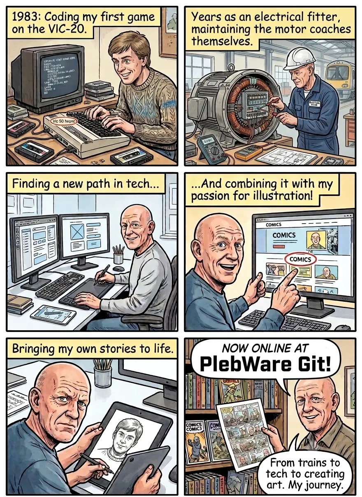
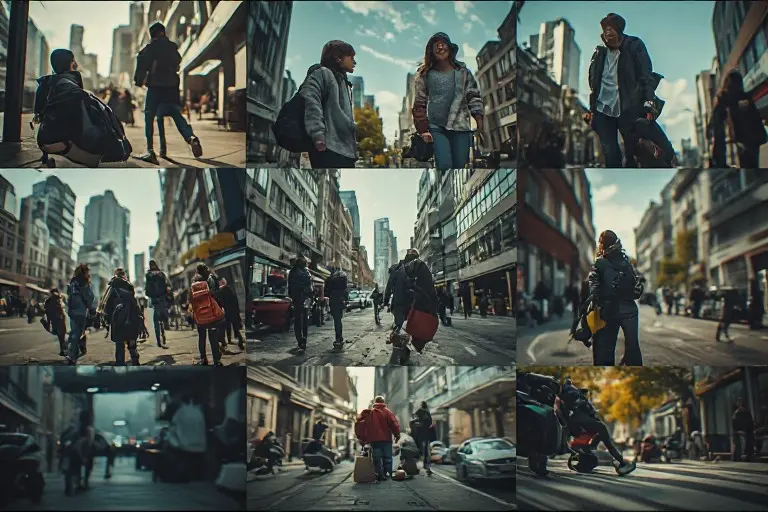
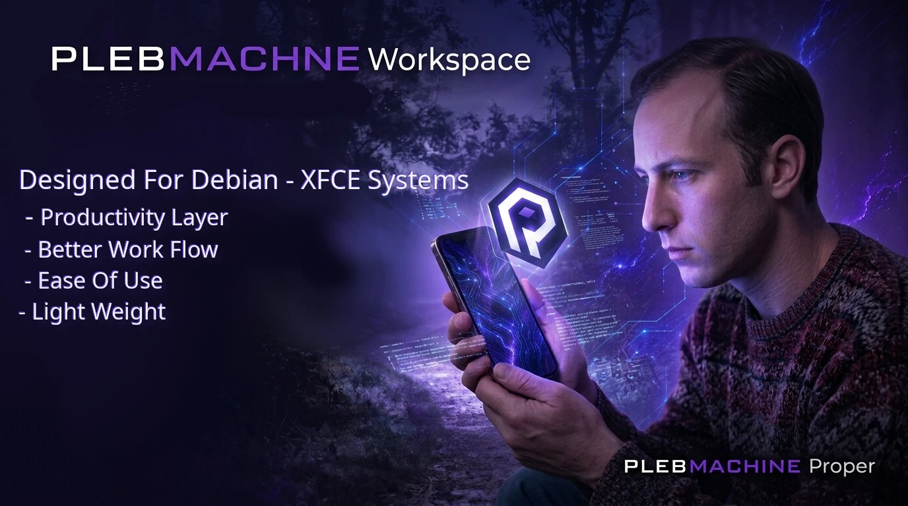
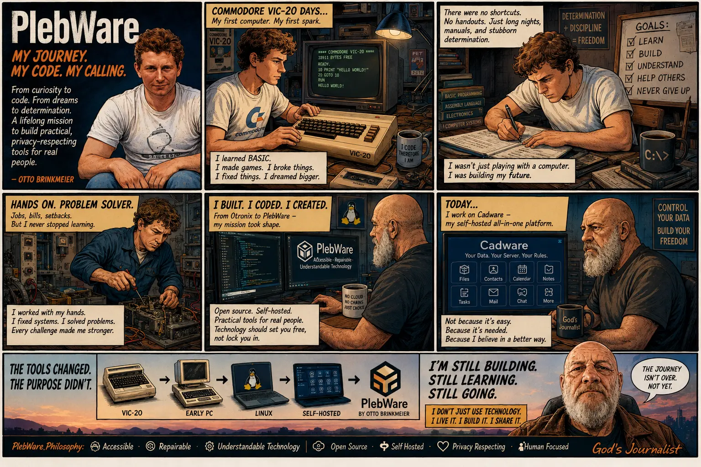
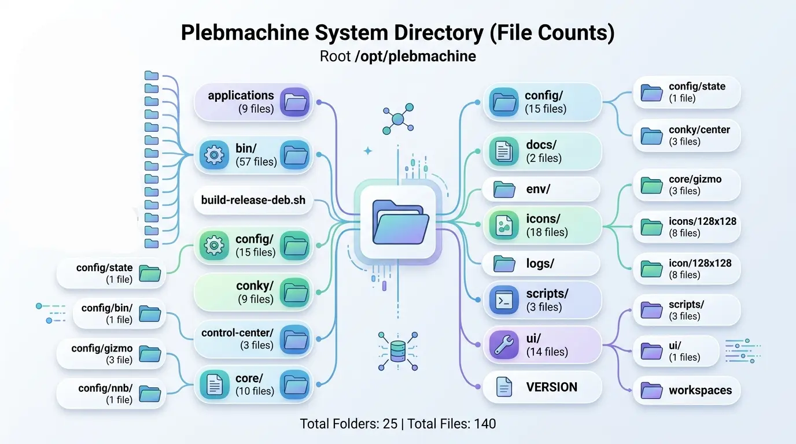
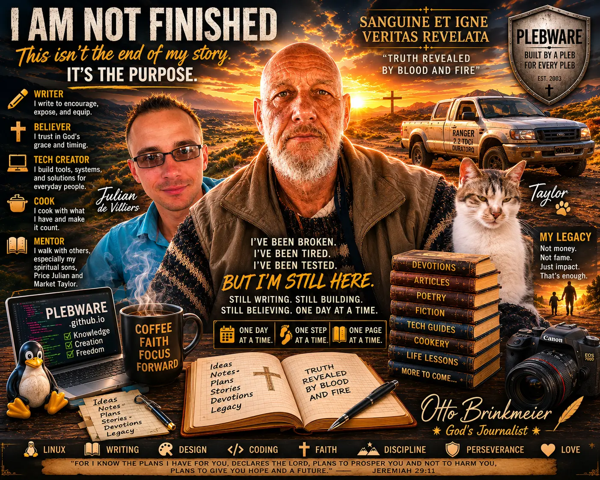
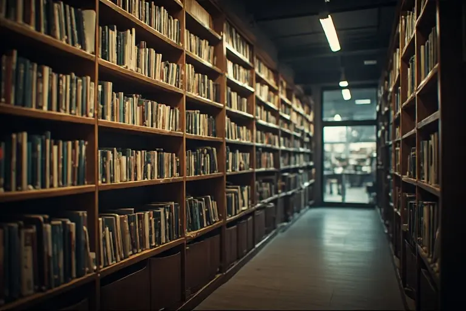

<link rel="stylesheet" href="https://raw.githubusercontent.com/Plebware/pleb-theme/redesign/editorial-mobile-first/assets/css/editorial.css">

<section class="pw-hero">
  

    
An independent publishing and learning hub.

    <h1>Knowledge for ordinary people.</h1>
    
A place to explore practical knowledge, technology, creativity, stories and ideas. Useful information should be understandable, accessible and available to everyone.

    

      <a class="pw-button" href="/everyday-default/">🌿 Explore Everyday</a>
      <a class="pw-button pw-button-secondary" href="#explore-modes">Explore PlebWare ↓</a>
    

  

  

    
  

</section>

<!-- PLEBVOX:START -->

<section class="pw-section" aria-labelledby="welcome-heading">
  

    

      
Welcome to PlebWare.

      <h2 id="welcome-heading">A library with room to explore.</h2>
    

  

  
PlebWare brings together everyday guidance, learning resources, research, writing, creative work and practical technology. Browse by interest, follow a subject, or simply see what catches your eye.

  

    <a class="pw-feature" href="/everyday-default/">
      
      

        <h3>Everyday knowledge.</h3>
        
Useful ideas and practical guidance for ordinary life.

      

    </a>
    <a class="pw-feature" href="/developer/">
      
      

        <h3>Technology with purpose.</h3>
        
Tools, systems and computing that serve people.

      

    </a>
    <a class="pw-feature" href="/graphics/">
      
      

        <h3>Creativity and expression.</h3>
        
Graphics, music, video, comics and creative experiments.

      

    </a>
  

</section>

<!-- PLEBVOX:END -->

<!-- PLEBVOX:START -->

<section class="pw-section" id="explore-modes" aria-labelledby="modes-heading">
  

    

      
Find your direction.

      <h2 id="modes-heading">Explore the PlebWare modes.</h2>
    

    <a class="pw-text-link" href="/all-posts/">Browse the library →</a>
  

  
Twelve areas of interest, each with its own subjects and growing collection of articles.

  

    <a class="pw-mode-card" href="/everyday-default/">🌿<strong>Everyday</strong><small>Practical life and useful skills.</small></a>
    <a class="pw-mode-card" href="/author/">✍️<strong>Author</strong><small>Fiction, poetry and the written word.</small></a>
    <a class="pw-mode-card" href="/study/">📚<strong>Study</strong><small>Learning, lessons and understanding.</small></a>
    <a class="pw-mode-card" href="/research/">🔬<strong>Research</strong><small>Investigation, evidence and discovery.</small></a>
    <a class="pw-mode-card" href="/graphics/">🎨<strong>Graphics</strong><small>Images, design and visual creativity.</small></a>
    <a class="pw-mode-card" href="/music/">🎵<strong>Music</strong><small>Sound, composition and music projects.</small></a>
    <a class="pw-mode-card" href="/video/">🎬<strong>Video</strong><small>Moving pictures and visual stories.</small></a>
    <a class="pw-mode-card" href="/broadcast/">📡<strong>Broadcast</strong><small>Radio, communication and publishing.</small></a>
    <a class="pw-mode-card" href="/ai-helpers/">🤖<strong>AI Helpers</strong><small>Practical ways to work with AI.</small></a>
    <a class="pw-mode-card" href="/developer/">💻<strong>Developer</strong><small>Software, code and digital tools.</small></a>
    <a class="pw-mode-card" href="/accounting/">💰<strong>Accounting</strong><small>Money, records and organisation.</small></a>
    <a class="pw-mode-card" href="/leisure/">🎮<strong>Leisure</strong><small>Hobbies, games and recreation.</small></a>
  

</section>

<!-- PLEBVOX:END -->

<!-- PLEBVOX:START -->

<section class="pw-section" aria-labelledby="recent-heading">
  

    

      
Fresh from the library.

      <h2 id="recent-heading">Recently published.</h2>
    

    <a class="pw-text-link" href="/all-posts/">All articles →</a>
  

  
  

    
      
      
      
      <article class="pw-article-card">
        {{ post_mode }}
        <h3><a href="{{ post.url | relative_url }}">{{ post.title | escape }}</a></h3>
        <time datetime="{{ post.date | date: '%Y-%m-%d' }}">{{ post.date | date: "%d %B %Y" }}</time>
        
          
{{ post.excerpt | strip_html | normalize_whitespace | truncate: 150 }}

        
          
Explore this article in the PlebWare library.

        
        <a class="pw-read-link" href="{{ post.url | relative_url }}">Read article →</a>
      </article>
    
  

  
A small selection of the latest work. The full library is always available.

</section>

<!-- PLEBVOX:END -->

<section class="pw-section" aria-labelledby="library-heading">
  

    

      
Growing knowledge.

      <h2 id="library-heading">The PlebWare library.</h2>
    

  

  
  
    
      
    
  
  

    
<strong>{{ site.posts.size }}</strong>Published articles.

    
<strong>{{ plebvox_count }}</strong>Articles enabled for PlebVox.

  

  
Some technical and code-heavy articles are intentionally not enabled for read-aloud.

</section>

<section class="pw-section pw-bottom-cta" aria-labelledby="everyday-cta-heading">
  

    
Start with something useful.

    <h2 id="everyday-cta-heading">Make Everyday your starting point.</h2>
    
Explore practical knowledge, household skills, cooking, personal organisation, technology and much more.

  

  <a class="pw-button" href="/everyday-default/">Visit Everyday →</a>
</section>

<section class="pw-section">
  

    

      
The wider ecosystem.

      <h2>More than a website.</h2>
    

  

  

    <a class="pw-feature" href="https://plebware.github.io/PlebMachine/">
      
      
<h3>PlebMachine.</h3>
Human-centred tools and a more intentional desktop experience.

    </a>
    <a class="pw-feature" href="/about/manifesto/">
      
      
<h3>Our founding idea.</h3>
Technology must serve humanity. Convenience is the purpose.

    </a>
    <a class="pw-feature" href="/search/">
      
      
<h3>Find what you need.</h3>
Search the collection or browse the complete article library.

    </a>
  

</section>

