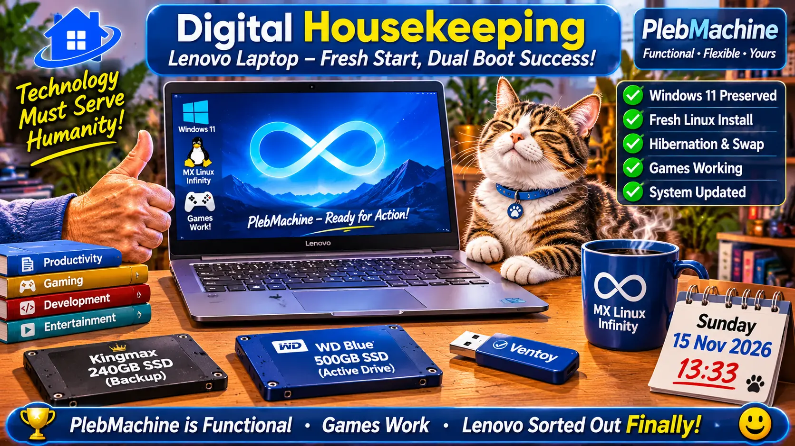

<!-- PLEBVOX:START -->

  

# 💻🚀 PlebMachine's Dev Machine Finally Sorted! 
## Windows, Linux, Games and PlebMachine.

**Sunday, 15 November 2026 — 13:33.**

Well, brother, we can finally say it!

The Lenovo is sorted out. Windows 11 is working, MX Linux Infinity is installed, PlebMachine is functional, and the games are running.

After several days of planning, investigating partitions, testing hardware, recovering our bearings and rebuilding the system, we've reached the destination.

And we did it without buying another laptop or another SSD.

This is the story of our November digital housekeeping adventure: how an existing 500GB Western Digital SSD became the foundation for a refreshed dual-boot system, how the original Kingmax was preserved, and how a fresh MX Linux installation gave PlebMachine a new working environment.

There were a few twists along the way, but that's half the fun of working with computers!

**The final result? Lenovo sorted. PlebMachine functional. Games working. Mission accomplished!** 🎉

<!-- PLEBVOX:END -->

<!-- PLEBVOX:START -->

## 🔧 1. It Started With an SSD Upgrade.

Earlier in November, we completed the first stage of the Lenovo project.

The machine is a Lenovo IdeaPad 130-15IKB, model 81H7.

Its original storage was a 240GB Kingmax SSD, which was becoming increasingly cramped for a dual-boot Windows and Linux installation.

Fortunately, an existing 500GB Western Digital WD Blue SSD was available.

We did not purchase a new drive. We made better use of hardware already in our possession.

The original Kingmax was cloned to the WD Blue using Rescuezilla, with proportional partition resizing.

The original drive was retained rather than erased.

That decision would prove particularly useful later.

<!-- PLEBVOX:END -->

<!-- PLEBVOX:START -->

## 💾 2. Keeping the Original Kingmax.

One of the most reassuring discoveries during this project was that the original Kingmax SSD could still be connected through our USB-to-SATA adapter.

Using the Lenovo's F12 boot menu, we successfully started the older MX Linux installation from the external drive.

We also tested its Windows installation externally.

This confirmed that the original drive remained a useful fallback.

It is important not to confuse this with a complete backup of every later change made to the WD Blue. The Kingmax preserved the older installation and its valuable files, while the newer WD Blue remained our working system drive.

We deliberately left the original Kingmax untouched.

Sometimes keeping the old hardware is worth more than immediately finding another use for it.

<!-- PLEBVOX:END -->

<!-- PLEBVOX:START -->

## 🛡️ 3. Investigating the Windows Recovery Partitions.

Before rebuilding Linux, we needed to understand exactly what Windows was using.

Our investigation revealed two Windows Recovery partitions:

- An older Recovery partition of approximately 864 MiB.
- A newer partition of approximately 1.5 GiB, labelled **Windows RE tools**.

We used Windows PowerShell and the `reagentc /info` command to inspect the Windows Recovery Environment.

The earlier check reported Windows Recovery enabled on partition 4.

That information guided our decision to preserve the newer Recovery partition and remove the older one.

We also identified the Windows EFI and Microsoft Reserved partitions.

The objective was clear: preserve the Windows installation and its boot infrastructure while clearing the old Linux installation for a fresh start.

<!-- PLEBVOX:END -->

<!-- PLEBVOX:START -->

## 📊 4. The New Partition Plan.

The internal WD Blue appeared in GParted as `/dev/sda`, with a capacity of approximately 465.76 GiB.

The existing layout included:

- EFI system partition: 100 MiB.
- Microsoft Reserved partition: 16 MiB.
- Windows 11: 200 GiB.
- New Windows RE tools: 1.5 GiB.
- Old Windows Recovery: 864 MiB.
- Previous Linux root: 92.64 GiB.
- Previous Linux home: 71.04 GiB.
- Existing unallocated space: approximately 99.62 GiB.

We preserved the first four partitions and removed the obsolete Recovery partition and the two old Linux partitions.

After those deletions, GParted reported approximately 264.15 GiB of unallocated space.

We then created two new Linux EXT4 partitions.

| Partition | Allocation | Purpose |
|---|---:|---|
| Linux root `/` | 90 GiB | MX Linux system |
| Linux home `/home` | Approximately 174 GiB | Personal files and projects |

The installer identified the new Linux partitions as `/dev/sda5` for Root and `/dev/sda6` for Home.

We deliberately gave Home more space than Root because personal files, writing, graphics and development projects need room to grow.

<!-- PLEBVOX:END -->

<!-- PLEBVOX:START -->

## 💤 5. Hibernation and Swap Space.

During the fresh MX Linux Infinity installation, the installer offered an option to configure hibernation and swap space.

We accepted.

The installer then created the corresponding hibernation and swap-space allocation as part of the installation process.

This was an important part of the setup because we wanted the laptop to have the appropriate facilities for memory management and hibernation.

We have not included an exact swap size or claimed a particular partition layout here. Those details should be recorded from the installed system's actual configuration rather than guessed.

The important point is that we accepted the installer's hibernation and swap configuration instead of skipping it.

<!-- PLEBVOX:END -->

<!-- PLEBVOX:START -->

## 🐧 6. Installing MX Linux Infinity.

With the partition layout prepared, we moved to the MX Linux Infinity installer.

The existing EFI partition was assigned as the EFI System Partition without formatting it.

The Windows partitions were left intact.

The new Linux partitions were assigned as follows:

- `/dev/sda5` — Root `/`, 90 GiB.
- `/dev/sda6` — Home `/home`, approximately 174 GiB.

The installer completed successfully.

We then reached the first important test.

Would the Lenovo still boot Windows?

Yes!

Windows 11 started successfully, accepted the login PIN and loaded normally.

Next, we restarted and selected MX Linux Infinity.

The new Linux installation booted successfully too.

The login password was accepted, and we reached the fresh desktop.

**Two operating systems. One laptop. Both working.** 🎉

<!-- PLEBVOX:END -->

<!-- PLEBVOX:START -->

## 🔄 7. Updating the Fresh Installation.

After logging into MX Linux Infinity, the system reported available upgrades.

We opened the update manager and allowed the updates to complete.

This included normal package maintenance associated with a fresh installation, including LibreOffice components.

We did not interrupt the update process.

Once the system was ready, we continued with the remaining configuration and testing.

<!-- PLEBVOX:END -->

<!-- PLEBVOX:START -->

## 🧠 8. PlebMachine Is Functional!

Now we come to one of the most important reasons for undertaking this rebuild.

PlebMachine.

The fresh MX Linux installation gives us a clean working foundation for continued development.

PlebMachine is now functional on the Lenovo.

This is an important milestone for a project that has been part of our development journey for years.

The objective remains to create a context-aware desktop environment that helps users organise their computing experience without taking control away from them.

Our guiding philosophy remains:

**Technology Must Serve Humanity, Not The Other Way Around.**

PlebMachine is intended to help people work more comfortably, understand their environment and make informed decisions.

The computer does not make the decision. It helps you think through the decision.

There is still development and testing ahead, but having PlebMachine functional on the freshly installed system is a significant achievement.

<!-- PLEBVOX:END -->

<!-- PLEBVOX:START -->

## 🎮 9. The Games Are Working Too!

A computer is not only a workstation.

Sometimes it is also an entertainment centre, a gaming machine and a place to unwind.

During the housekeeping process, we also worked on getting our gaming environment running properly.

Lutris and the Windows gaming components required attention, and we spent time resolving issues with the gaming setup.

The good news is that the games are working!

That is another important part of the Lenovo rebuild.

We wanted a machine that could support everyday computing, writing, development and gaming rather than one restricted to a single purpose.

**Productivity, development and gaming can share the same machine.**

<!-- PLEBVOX:END -->

<!-- PLEBVOX:START -->

## 🧰 10. More Than Just a Reinstallation.

This project involved much more than clicking an installer button.

We investigated the Windows Recovery Environment, checked the original SSD, used a USB-to-SATA adapter, examined partition tables, prepared the new Linux layout and verified both operating systems.

We also considered the way PlebMachine would fit into the new installation.

The experience reinforced several useful lessons:

- Keep original hardware when it contains valuable data.
- Understand the Windows boot and recovery partitions before changing anything.
- Inspect partition layouts instead of relying on assumptions.
- Use the correct mount points during Linux installation.
- Allow system updates to finish properly.
- Test each operating system after installation.
- Verify that the applications and tools you depend on actually work.

Most importantly, we avoided unnecessary spending by using equipment already available.

The original Kingmax remains preserved, and the WD Blue is now the active system drive.

<!-- PLEBVOX:END -->

<!-- PLEBVOX:START -->

## 🏁 11. Sunday, 15 November: Mission Accomplished!

At 13:33 on Sunday afternoon, we could finally look at the Lenovo and say:

**Sorted out. Finally!**

The Windows 11 installation works.

MX Linux Infinity works.

PlebMachine is functional.

The games work.

The fresh installation has its hibernation and swap configuration.

The original Kingmax remains untouched as a fallback.

There are always further improvements to make, and PlebMachine development will continue, but the central objective of this housekeeping project has been achieved.

We have a refreshed dual-boot Lenovo with a clean Linux installation and a working environment for the next stage of development.

And we did it by making better use of what we already owned.

<!-- PLEBVOX:END -->

<!-- PLEBVOX:START -->

## 💙 The Bigger Lesson: Convenience and Empowerment.

At PlebWare, we believe that technology should serve people.

A computer should not dictate how its owner works, what they can create or how they organise their digital life.

Good housekeeping is about maintaining the tools we depend on, protecting our information and making sure that our equipment remains useful.

This Lenovo project is a practical example.

We did not replace the laptop. We did not purchase another SSD. We investigated, planned, reused, rebuilt and tested.

The result is a machine ready for writing, everyday work, gaming and continued PlebMachine development.

**Convenience is the objective. Empowerment is the outcome. Human freedom remains the safeguard.**

And with that, the Lenovo chapter of our November digital housekeeping adventure is officially closed.

Well, at least until the next improvement comes along! 😁

<!-- PLEBVOX:END -->

---

✍️ **Otto Brinkmeier**
*PlebWare Contributor*

*The Keyboard Is Mightier Than The Pen.*

<!-- SPACE -->
<!-- REVIEWED -->
<!-- SPACE -->
