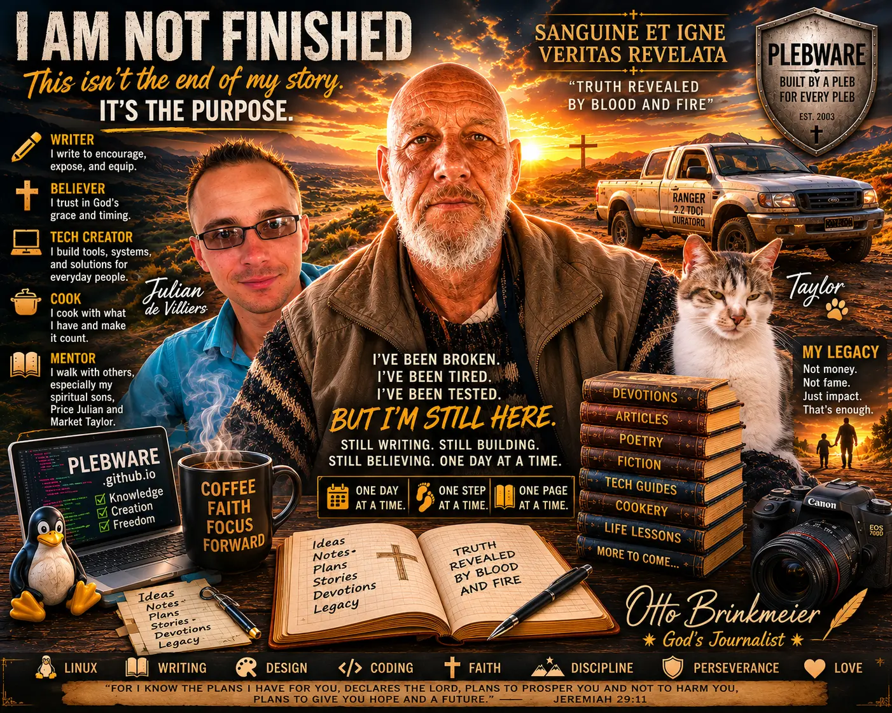

<link rel="stylesheet" href="{{ '/assets/css/editorial-preview.css' | relative_url }}">

<section class="pw-hero">
  

    
An independent publishing and learning hub.

    <h1>Knowledge for ordinary people.</h1>
    
A place to explore practical knowledge, technology, creativity, stories and ideas. Useful information should be understandable, accessible and available to everyone.

    

      <a class="pw-button" href="/everyday-default/">🌿 Explore Everyday</a>
      <a class="pw-button pw-button-secondary" href="/discover-plebware/">🌐 Discover PlebWare</a>
      <a class="pw-button pw-button-secondary" href="#explore-modes">Explore PlebWare ↓</a>
    

  

</section>



<!-- PLEBVOX:START -->

<section class="pw-section pw-monthly-spotlight" aria-labelledby="monthly-spotlight-heading">
  

    

      
{{ spotlight.eyebrow | escape }}

      <h2 id="monthly-spotlight-heading">{{ spotlight.title | escape }}</h2>
    

  

  

    
  

  
{{ spotlight.description | escape }}

  

    <a class="pw-button" href="{{ spotlight.link }}">{{ spotlight.button | escape }} →</a>
  

</section>

<!-- PLEBVOX:END -->


<!-- PLEBVOX:START -->

<section class="pw-section" aria-labelledby="welcome-heading">
  

    

      
Welcome to PlebWare.

      <h2 id="welcome-heading">A library with room to explore.</h2>
    

  

  
PlebWare brings together everyday guidance, learning resources, research, writing, creative work and practical technology. Browse by interest, follow a subject, or simply see what catches your eye.

  

    

      
      <button class="pw-gallery-arrow prev" type="button" data-prev aria-label="Previous mode">‹</button>
      <button class="pw-gallery-arrow next" type="button" data-next aria-label="Next mode">›</button>
      <button class="pw-gallery-expand" type="button" data-expand>⛶ Expand image</button>
    

    

      

Featured mode · 1 / 12
<h3><a data-title-link href="/everyday-default/">Everyday.</a></h3>
Practical knowledge and useful skills for everyday life.

      Select the image to explore.
    

    

  

<!-- PLEBVOX:END -->

<!-- PLEBVOX:START -->
<section class="pw-section" aria-labelledby="comic-gallery-heading">
  

    

Stories in pictures.
<h2 id="comic-gallery-heading">The PlebWare comic gallery.</h2>

  

  
A visual collection of published illustrations from Author → Comics. Browse the artwork without leaving the homepage.

  

    

      
      <button class="pw-gallery-arrow prev" type="button" data-prev aria-label="Previous comic">‹</button>
      <button class="pw-gallery-arrow next" type="button" data-next aria-label="Next comic">›</button>
      <button class="pw-gallery-expand" type="button" data-expand>⛶ Expand image</button>
    

    

      

Author Comics · Loading gallery…
<h3 data-comic-title>Finding published comics…</h3>
Selected artwork from the published comic collection.

      Display only.
    

    

  

  

    
    
      
        
        
        
        
        
          
        
          
        
        
          
        
      
    
  

</section>
<!-- PLEBVOX:END -->

<dialog class="pw-image-viewer" data-viewer aria-label="Full-screen image viewer">
  

Image viewer
<button type="button" data-close>✕ Close</button>

  

  
Use the arrow keys to browse · Esc to close

</dialog>

<!-- PLEBVOX:START -->

<section class="pw-section" id="explore-modes" aria-labelledby="modes-heading">
  

    

      
Find your direction.

      <h2 id="modes-heading">Explore the PlebWare modes.</h2>
    

    <a class="pw-text-link" href="/all-posts/">Browse the library →</a>
  

  
Twelve areas of interest, each with its own subjects and growing collection of articles.

  

    <a class="pw-mode-card" href="/everyday-default/">🌿<strong>Everyday</strong><small>Practical life and useful skills.</small></a>
    <a class="pw-mode-card" href="/author/">✍️<strong>Author</strong><small>Fiction, poetry and the written word.</small></a>
    <a class="pw-mode-card" href="/study/">📚<strong>Study</strong><small>Learning, lessons and understanding.</small></a>
    <a class="pw-mode-card" href="/research/">🔬<strong>Research</strong><small>Investigation, evidence and discovery.</small></a>
    <a class="pw-mode-card" href="/graphics/">🎨<strong>Graphics</strong><small>Images, design and visual creativity.</small></a>
    <a class="pw-mode-card" href="/music/">🎵<strong>Music</strong><small>Sound, composition and music projects.</small></a>
    <a class="pw-mode-card" href="/video/">🎬<strong>Video</strong><small>Moving pictures and visual stories.</small></a>
    <a class="pw-mode-card" href="/broadcast/">📡<strong>Broadcast</strong><small>Radio, communication and publishing.</small></a>
    <a class="pw-mode-card" href="/ai-helpers/">🤖<strong>AI Helpers</strong><small>Practical ways to work with AI.</small></a>
    <a class="pw-mode-card" href="/developer/">💻<strong>Developer</strong><small>Software, code and digital tools.</small></a>
    <a class="pw-mode-card" href="/accounting/">💰<strong>Accounting</strong><small>Money, records and organisation.</small></a>
    <a class="pw-mode-card" href="/leisure/">🎮<strong>Leisure</strong><small>Hobbies, games and recreation.</small></a>
  

</section>

<!-- PLEBVOX:END -->

<!-- PLEBVOX:START -->

<section class="pw-section" aria-labelledby="recent-heading">
  

    

      
Fresh from the library.

      <h2 id="recent-heading">Recently published.</h2>
    

    <a class="pw-text-link" href="/all-posts/">All articles →</a>
  

  
  

    
      
      
      
      <article class="pw-article-card">
        {{ post_mode }}
        <h3><a href="{{ post.url | relative_url }}">{{ post.title | escape }}</a></h3>
        <time datetime="{{ post.date | date: '%Y-%m-%d' }}">{{ post.date | date: "%d %B %Y" }}</time>
        
          
{{ post.excerpt | strip_html | normalize_whitespace | truncate: 150 }}

        
          
Explore this article in the PlebWare library.

        
        <a class="pw-read-link" href="{{ post.url | relative_url }}">Read article →</a>
      </article>
    
  

  
A small selection of the latest work. The full library is always available.

</section>

<!-- PLEBVOX:END -->

<section class="pw-section" aria-labelledby="library-heading">
  

    

      
Growing knowledge.

      <h2 id="library-heading">The PlebWare library.</h2>
    

  

  
  
  
  
    
    
      
    
    
      
    
    
      
    
  
  

    
<strong>{{ site.posts.size }}</strong>Published articles.

    
<strong>{{ plebvox_count }}</strong>PlebVox-enabled articles.

    
<strong>{{ reviewed_count }}</strong>Human-reviewed articles.

    
<strong>{{ voxed_count }}</strong>PlebVoxed articles.

  

  
Verification counts recognise the published article markers. PlebVoxed means the full audio rendition has been listened to and approved by a human moderator. An article may count as both human-reviewed and PlebVoxed.

</section>

<section class="pw-section pw-bottom-cta" aria-labelledby="everyday-cta-heading">
  

    
Start with something useful.

    <h2 id="everyday-cta-heading">Make Everyday your starting point.</h2>
    
Explore practical knowledge, household skills, cooking, personal organisation, technology and much more.

  

  <a class="pw-button" href="/everyday-default/">Visit Everyday →</a>
</section>

<section class="pw-section">
  

    

      
The wider ecosystem.

      <h2>More than a website.</h2>
    

  

  

    <a href="https://plebware.github.io/PlebMachine/"><strong>PlebMachine.</strong>Human-centred tools and a more intentional desktop experience.</a>
    <a href="/about/manifesto/"><strong>Our founding idea.</strong>Technology must serve humanity. Convenience is the purpose.</a>
    <a href="/search/"><strong>Find what you need.</strong>Search the collection or browse the complete article library.</a>
  

</section>

<!-- PLEBVOX:START -->
<section class="pw-section" id="about-plebware" aria-labelledby="about-plebware-heading">
  

The story behind the project.
<h2 id="about-plebware-heading">About PlebWare.</h2>

  
PlebWare is an independent publishing and learning hub maintained by Otto Brinkmeier and Jullian “Juelz” De Villiers. It brings together practical knowledge, learning, research, writing, technology and creative work. Its guiding belief is simple: technology must serve humanity, and convenience is the purpose.

  

    <a class="pw-feature" href="/everyday/about-plebware/">

Explore the foundations.
<h3>PlebWare Under the Microscope.</h3>
Take a closer look at the ideas, people, purpose and principles behind PlebWare.

</a>
    <a class="pw-feature" href="/about/the-plebware-lexicon/">

Understand the language.
<h3>The PlebWare Lexicon.</h3>
A guide to the names, concepts and terminology used throughout the PlebWare ecosystem.

</a>
    <a class="pw-feature" href="/everyday/about-plebware/2026/10/17/welcome-aboard-the-journey.html">

New to the journey?
<h3>Welcome Aboard.</h3>
A personal introduction to the people, experiences and values behind this project.

</a>
  

  
Read <a class="pw-text-link" href="/everyday/about-plebware/2026/09/17/who-or-what-is-plebware.html">Who or What Is PlebWare?</a> for the meaning behind the name and the wider ecosystem.

</section>
<!-- PLEBVOX:END -->

<!-- PLEBVOX:START -->
<section class="pw-section" id="plebmachine" aria-labelledby="plebmachine-heading">
  

The workshop beyond the website.
<h2 id="plebmachine-heading">PlebMachine.</h2>

  
Software built for minds, not mass production. PlebMachine is the PlebWare vision for human-centred desktop tools and a cognitive desktop orchestrator: practical software designed to help people work, create, research and organise their digital lives without unnecessary complexity.

  

    <a class="pw-button" href="https://plebware.github.io/PlebMachine/">Explore PlebMachine.</a>
    <a class="pw-button pw-button-secondary" href="/developer/plebmachine/2026/09/23/plebmachine-2027-critical-plan-of-action.html">Critical Plan of Action.</a>
    <a class="pw-button pw-button-secondary" href="/developer/plebmachine/2026/10/10/the-story-behind-plebmachine-pro.html">The Story Behind PlebMachine Pro.</a>
  

</section>
<!-- PLEBVOX:END -->

<section class="pw-section" aria-labelledby="manifesto-heading">
  

Our principles.
<h2 id="manifesto-heading">The PlebWare legacy manifesto.</h2>

  

</section>

<!-- PLEBVOX:START -->
<section class="pw-section" aria-labelledby="update-heading">
  

What has changed?
<h2 id="update-heading">Latest PlebWare update.</h2>

  
This update is refreshed occasionally when major improvements, developments or site changes are implemented.

  
  
    <article class="pw-article-card">
      <h3><a href="{{ latest_update.url | relative_url }}">{{ latest_update.title | escape }}</a></h3>
      <time datetime="{{ latest_update.date | date: '%Y-%m-%d' }}">{{ latest_update.date | date: "%d %B %Y" }}</time>
      
{{ latest_update.excerpt | strip_html | normalize_whitespace | truncate: 280 }}

      <a class="pw-read-link" href="{{ latest_update.url | relative_url }}">Read the latest update →</a>
    </article>
  
</section>
<!-- PLEBVOX:END -->

<section class="pw-section" aria-labelledby="find-heading">
  

A growing collection.
<h2 id="find-heading">Find something useful.</h2>

  
With hundreds of articles covering technology, creativity, practical life, writing, research, education and entertainment, there is plenty to explore.

  

  

    <a class="pw-button" href="/search/">Search PlebWare.</a><a class="pw-button pw-button-secondary" href="/all-posts/">Browse all articles.</a><a class="pw-button pw-button-secondary" href="/subcategory-dashboard/">12-mode subcategory dashboard.</a>
  

</section>

<section class="pw-section" aria-labelledby="contributors-heading">
  

People make the project.
<h2 id="contributors-heading">PlebWare contributors.</h2>

  
PlebWare is built by people who contribute ideas, code, research, writing and creativity. This list is generated from the PlebWare GitHub repository.

  

🔄 Loading contributors...

</section>

<section class="pw-section" aria-labelledby="dashboard-heading">
  

Explore the structure.
<h2 id="dashboard-heading">The PlebWare subcategory dashboard.</h2>

  
</section>

<section class="pw-section" aria-labelledby="visitors-heading">
  

A worldwide community.
<h2 id="visitors-heading">PlebWare visitors around the world.</h2>

  

</section>

<section class="pw-section" aria-labelledby="comments-heading">
  

Join the conversation.
<h2 id="comments-heading">Comments.</h2>

  

</section>

<!-- SPACE -->

<!-- REVIEWED -->

<!-- SPACE -->

